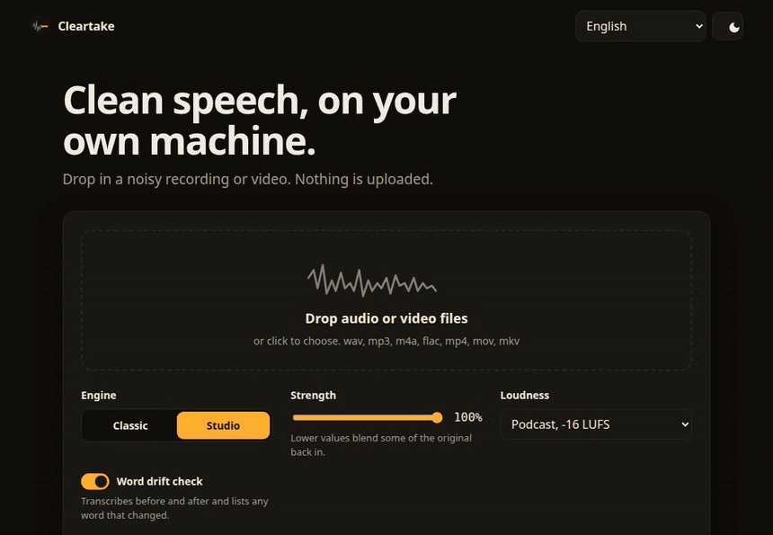

<h1 align="center">
  <br>
  Cleartake
</h1>

<p align="center">
  <strong>Macht aus einer verrauschten Aufnahme einen sauberen Take und prüft, dass niemandes Worte sich verändert haben.</strong>
</p>

<p align="center">
  <a href="https://github.com/Arthur031221/Cleartake/actions/workflows/ci.yml"></a>
  <a href="LICENSE"></a>
  
  <a href="https://arthur031221.github.io/Cleartake/"></a>
</p>

<p align="center">
  <a href="README.md">English</a> | <a href="README.zh-TW.md">繁體中文</a> | <a href="README.zh-CN.md">简体中文</a> | <a href="README.ja.md">日本語</a> | <a href="README.ko.md">한국어</a> | <a href="README.es.md">Español</a> | <a href="README.fr.md">Français</a> | Deutsch | <a href="README.pt-BR.md">Português (BR)</a>
</p>

<p align="center">
  
</p>

Ich habe Cleartake für die Aufnahme gebaut, die bis auf Rauschen, Lüfter und Raumklang gut ist. Es führt ein Modell zur Sprachverbesserung auf Ihrem Rechner aus, stellt die Lautheit auf ein Sendeziel ein, behält das Videobild Byte für Byte und transkribiert dann Original und Ergebnis, um jedes veränderte Wort zu zeigen. Es wird nichts hochgeladen.

```bash
uv tool install git+https://github.com/Arthur031221/Cleartake
cleartake serve --open
```

Der DNSMOS-Hintergrundwert steigt von **2,98 auf 4,08** und der Gesamtwert von **2,59 auf 3,14** auf 103 VoiceBank-DEMAND-Testclips, mit der Studio-Engine und nur der Verbesserungsstufe, bei 13,8-facher Echtzeit auf einer RTX 5090.<br>
<sub>Methode: jeder achte der 824 Testsätze, Stärke 1,0, ohne Lautheitsschritt, DNSMOS P.835 über `speechmos`, GPU aufgewärmt. Die Wortfehlerrate hat sich bei diesem leichten Rauschen nicht verbessert. Die vollständige Tabelle samt Einschränkungen steht in [benchmarks/README.md](benchmarks/README.md) (auf Englisch).</sub>

## Vorher und nachher

Ein Clip aus dem Demo-Set (VoiceBank-DEMAND, Sprecher p232, 28,4 Sekunden, 81 Wörter), Standardeinstellungen, gemessen an den Dateien in [docs/demo](docs/demo).

|  | Original | Cleartake | Bedeutung |
| --- | --- | --- | --- |
| DNSMOS gesamt | 2,63 | 3,33 | vorhergesagte Qualität, 1 bis 5 |
| DNSMOS Sprache | 3,46 | 3,54 | die Stimme selbst ändert sich kaum |
| DNSMOS Hintergrund | 2,86 | 4,14 | verschwinden soll das Rauschen |
| Integrierte Lautheit | -22,2 LUFS | -16,2 LUFS | Preset podcast |
| True Peak | -4,3 dBTP | -1,6 dBTP | die Obergrenze liegt bei -1,5 |
| Geänderte Wörter | | 0 von 81 | Whisper `base.en`, Wort für Wort abgeglichen |

Ich behaupte nicht, dass ein Entrauscher Sprache repariert. Cleartake entfernt das Rauschen und prüft dann das Ergebnis, sodass ein geändertes Wort eine Zeile im Bericht ist und keine Überraschung im Programm. [Im Browser ausprobieren](https://arthur031221.github.io/Cleartake/). Die gehostete Seite spielt genau diesen Clip ab und rechnet nichts.

## Die Pipeline

```
 decode            enhance            finish             check              write
+----------+      +----------+      +----------+      +----------+      +----------+
| any file |  ->  | speech   |  ->  | loudness |  ->  | word     |  ->  | audio or |
| to 48 kHz|      | model    |      | and peak |      | drift    |      | video    |
| mono     |      | on-device|      | target   |      | report   |      | + JSON   |
+----------+      +----------+      +----------+      +----------+      +----------+
 cleartake in.mp4  --engine studio   --preset podcast  --whisper small   -o out/ --json
```

| Was Sie tun | Befehl | Leitprinzip |
| --- | --- | --- |
| Eine Datei bereinigen | `cleartake interview.mp4` | Das Ergebnis liegt neben der Eingabe, die Eingabe wird nie angefasst |
| Einen Ordner bereinigen | `cleartake episodes/ -o cleaned/` | Eine defekte Datei stoppt den Stapel nicht, und Dateien, die schon `.cleartake` heißen, werden übersprungen |
| Etwas Raum behalten | `cleartake talk.wav --strength 0.7` | Das Original wird zugemischt, statt alles oder nichts zu wählen |
| Ein Plattformziel treffen | `cleartake talk.wav --preset youtube` | Erst Verstärkung, dann Limiter, und der Bericht zeigt den gemessenen Wert |
| Wortprüfung überspringen | `cleartake talk.wav --no-check` | Die Prüfung kostet einen Whisper-Durchlauf und lässt sich abschalten |
| In einer anderen Sprache prüfen | `cleartake talk.wav --language de --whisper small` | Nehmen Sie ein Modell, das lesen kann, was gesagt wurde |
| Im Browser arbeiten | `cleartake serve --open` | Eine lokale Web-App: mehrere Dateien ablegen, jede einzeln abbrechen, dann mit A/B-Player, Spektrogramm und Wortliste vergleichen |
| Per Skript nutzen | `cleartake in.wav --json` | Der Bericht geht nach stdout und der Fortschritt nach stderr |
| Einrichtung prüfen | `cleartake doctor` | Zeigt ffmpeg, das Gerät und die geladenen Modelle an, bevor Sie auf einen Download warten |

## Installation

Sie brauchen Python 3.10 bis 3.12 und ffmpeg. Cleartake ist noch nicht auf PyPI.

```bash
uv tool install git+https://github.com/Arthur031221/Cleartake
cleartake doctor
cleartake your-recording.wav
```

Der erste Lauf lädt das gewählte Modell (etwa 210 MB für studio, 161 MB für classic) und Whisper `base.en` (etwa 141 MB). Danach läuft alles offline. Die Werkzeugumgebung war auf meinem Rechner 6,2 GB groß, weil PyTorch seine CUDA-Bibliotheken mitbringt, und das Wheel war in 75 Sekunden installiert.

## Bausteine nach Stufe

* **Dekodieren.** Jeder Container, den ffmpeg liest, geht hinein, das interne Signal ist 48 kHz mono als Gleitkomma. Ein Video behält sein Bild mit `-c:v copy`. Cleartake bildet vorher und nachher einen Hash der Videopakete, und der Bericht nennt `picture_kept: true` nur, wenn die Hashes übereinstimmen. Nur der erste Videostream und der neue Ton bleiben erhalten, zusätzliche Tonspuren und Untertitel gehen verloren.
* **Verbessern.** `studio` (Standard) ist MossFormer2_SE_48K, volle Bandbreite bei 48 kHz. `classic` ist FRCRN_SE_16K und behält Sprache bis 8 kHz. Es ist keine Geschwindigkeitsoption, denn auf 3 CPU-Kernen lief es mit 0,7-facher Echtzeit gegenüber 3,2 bei studio. Beide stammen aus ClearerVoice-Studio unter Apache-2.0.
* **Abschließen.** Integrierte Lautheit nach EBU R128, gemessen mit `ebur128` von ffmpeg, dann Verstärkung, dann `alimiter`. Presets: podcast -16 LUFS, youtube -14, broadcast -23 mit einer Obergrenze von -1,0 dBTP, oder `none`.
* **Prüfen.** faster-whisper transkribiert beide Fassungen auf der CPU, und die Transkripte werden mit `difflib` abgeglichen. Jeder Unterschied steht mit Zeitstempel in der Liste, damit Sie ihn anhören können. Die Web-App markiert sie im Transkript.
* **Schreiben.** Audio geht als wav, flac, m4a oder mp3 hinaus. `<output>.json` hält Lautheit vorher und nachher, Engine, Gerät, Geschwindigkeit und Wortunterschiede fest. Ein Video kommt als mp4, mov oder mkv passend zur Eingabe heraus, webm-, m4v- und avi-Eingaben werden zu mkv.

## Gemessen

103 VoiceBank-DEMAND-Clips, DNSMOS P.835, RTX 5090. Methode und Wiederholung stehen in [benchmarks/README.md](benchmarks/README.md).

| Variante | OVRL | SIG | BAK | WER gegen sauberes Transkript | Tempo |
| --- | --- | --- | --- | --- | --- |
| noisy | 2,59 | 3,22 | 2,98 | 5,4% | n/a |
| classic | 3,17 | 3,44 | 4,06 | 5,1% | 12,7x |
| studio | 3,14 | 3,40 | 4,08 | 6,6% | 13,8x |

Weitere Zeiten: Ein Video von 76 Sekunden brauchte ohne Wortprüfung 6,6 Sekunden von Anfang bis Ende (11,5-fach). Ein Clip von 25 Sekunden auf 3 CPU-Kernen brauchte mit studio 8,0 Sekunden und mit classic 35,7 Sekunden.

## Grenzen, die ich kenne

* **Die Wortfehlerrate hat sich nicht verbessert.** Bei diesem leichten Rauschen liest Whisper die Eingabe schon gut. Studio lag 1,2 Punkte über der verrauschten Eingabe und classic 0,3 Punkte darunter, und mit 103 Clips kann ich die beiden nicht unterscheiden. Zwei Läufe desselben Befehls schwankten um etwa einen halben Punkt.
* **Die Wortprüfung ist ein Hinweis, wo man hinhören sollte, kein Urteil.** Im Benchmark meldet sie etwa 7% der Wörter als verschieden, darunter Schreibvarianten und Wörter, die das verrauschte Original falsch verstanden hat. Eine Änderung, die Whisper nicht hören kann, entgeht ihr.
* **Das Lautheitsziel kann um etwa 0,5 LU verfehlt werden,** wenn die True-Peak-Obergrenze die Verstärkung zuerst stoppt.
* **Qualitätswerte sind Vorhersagen.** DNSMOS ist ein gelerntes Modell und kein Hörtest, und ich habe nur englische Sprache mit den DEMAND-Rauscharten geprüft. Musik, Nachhall und andere Sprachen sind nicht gemessen.
* **Die echten Modelle liefen nur unter Linux** (eine RTX 5090 und 3 CPU-Kerne, Python 3.10 und 3.12). Die Tests ohne Browser laufen in der CI auch unter macOS (Apple Silicon) und Windows, dort mit einem Ersatz für die Modelle. Ein Docker-Image gibt es noch nicht.
* **Die Wortprüfung der Web-App in anderen Sprachen ist ungetestet.** Englisch nutzt Whisper `base.en`. Jede andere Sprache, die Sie in der Einrichtungskarte wählen, oder die automatische Erkennung nutzt Whisper `small` (etwa 460 MB, einmal heruntergeladen). Die Genauigkeit pro Sprache habe ich nicht gemessen.
* **Der Stapelbetrieb braucht verschiedene Namen.** `-o` behält die Ordnerstruktur, und Cleartake startet nicht, wenn zwei Eingaben dieselbe Datei schreiben würden oder ein Ergebnis seine Eingabe ersetzen würde.
* **Es ist ein Download von mehreren Gigabyte** wegen PyTorch, und der erste Lauf braucht Netz für die Modelle.

## Dokumentation

Die vollständige Dokumentation ist auf Englisch: [Install](docs/install.md) | [Usage](docs/usage.md) | [Config](docs/config.md) | [Architecture](docs/architecture.md) | [Benchmark](benchmarks/README.md) | [Contributing](CONTRIBUTING.md) | [Changelog](CHANGELOG.md)

## Danksagung

* [ClearerVoice-Studio](https://github.com/modelscope/ClearerVoice-Studio) für die Verbesserungsmodelle (Apache-2.0).
* [faster-whisper](https://github.com/SYSTRAN/faster-whisper) und Whisper für die Wortprüfung.
* [VoiceBank-DEMAND](https://doi.org/10.7488/ds/2117) (CC BY 4.0) für die Demo-Clips und den Benchmark.
* DNSMOS P.835 von Microsoft, ausgeführt mit `speechmos`.

MIT-Lizenz. Siehe [LICENSE](LICENSE).

Assisted by Claude/Codex.
